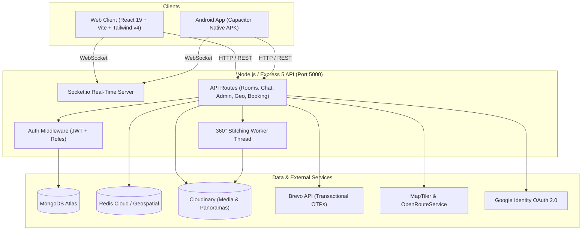

# RentPE - Next-Gen Room Rental & 360° Virtual Tour Platform

[-blue.svg)](#)
[-black.svg)](#)
[](#)
[](#)
[](#)
[](#)
[](#)

> **Live Web Application:** [https://rentpe-e6km.onrender.com](https://rentpe-e6km.onrender.com)

**RentPE** is a modern, full-featured room rental marketplace powered by **Next.js 16 App Router (with advanced SSR Google SEO)** and a **real-time Node.js/Express 5 + Socket.io backend**, complemented by a native **Capacitor Android APK**. Designed for students, working professionals, and property owners, RentPE features **immersive 360° virtual tours**, **real-time chat with anti-scam protection**, **interactive MapLibre & routing**, and **automated Google Rich Snippets (Schema.org)**.

---

## 📑 Table of Contents

1. [Key Features Overview](#-key-features-overview)
2. [Deep-Dive Feature Breakdown](#-deep-dive-feature-breakdown)
   - [Room Seekers](#1-room-seeker-experience)
   - [Property Owners](#2-room-owner-suite)
   - [360° Virtual Tour & Panorama Stitching](#3-360-virtual-tour-engine)
   - [Interactive Maps & Route Navigation](#4-maps-geocoding--route-navigation)
   - [Real-Time Chat & Safety Shield](#5-real-time-chat--safety-system)
   - [Visit Scheduling & Inquiries](#6-inquiry--visit-scheduling-system)
   - [Admin Control Center](#7-admin-control-center)
   - [Native Android Experience (Capacitor)](#8-native-android-experience-capacitor)
3. [Technology Architecture](#-technology-architecture)
4. [Project Structure](#-project-structure)
5. [Prerequisites & Installation](#-prerequisites--installation)
6. [Environment Configuration (.env)](#-environment-configuration)
7. [Running the Application](#-running-the-application)
8. [Comprehensive API Reference](#-comprehensive-api-reference)
9. [Real-Time Socket Events](#-real-time-socket-events)
10. [Capacitor Android APK & GitHub Actions Workflow](#-capacitor-android-apk--github-actions-workflow)
11. [Deployment Guide (Render)](#-deployment-guide)

---

## 🌟 Key Features Overview

| Feature Category | Highlights |
| :--- | :--- |
| **Search & Discovery** | Instant indexing via FlexSearch, filters (budget, gender, amenities, furnishing, room type), Redis Geospatial radius query. |
| **360° Virtual Tours** | Three.js interactive 360° sphere viewer with zoom/fullscreen/rotation. Mobile guided 360° capture using device gyroscope. Automatic server-side panorama stitching via OpenCV / Sharp worker pipeline. |
| **Maps & Routing** | MapLibre GL with MapTiler vectors, OpenRouteService turn-by-turn routing, walking/driving distance & travel time calculator, Nominatim reverse geocoding. |
| **Real-Time Chat** | Socket.io messaging, typing indicators, read receipts, emoji picker, image/document sharing, audio notes, and owner quick-replies. |
| **Security & Trust** | AI keyword-based payment fraud detection, user blocking/reporting, verified OTP email via Brevo REST API, Google OAuth 2.0. |
| **Visit Booking** | Schedule on-site property visits directly inside the chat or listing page with accept/reject workflows. |
| **Ratings & Reviews** | Community-driven star ratings, detailed tenant feedback, owner moderation, and aggregate scoring. |
| **Admin Dashboard** | Real-time analytics, user role administration, room approval/takedown, city management, report escalation, flagged message moderation. |
| **Android Native App (Capacitor)** | High-performance Android APK packaging the React web application with hardware camera, GPS, and push notification readiness. |

---

## 🔍 Deep-Dive Feature Breakdown

### 1. Room Seeker Experience
- **Instant Search with FlexSearch**: High-speed, typo-tolerant search across titles, descriptions, landmarks, addresses, cities, amenities, and house rules.
- **Dynamic Multi-Parameter Filters**:
  - **Rent Range**: Custom minimum and maximum budget sliders.
  - **Property Type**: PG (Paying Guest), Hostel, Flat / Apartment, Independent House, Single Room.
  - **Tenant Compatibility**: Male, Female, Any / Family, Working Professionals, Students.
  - **Furnishing Level**: Fully Furnished, Semi-Furnished, Unfurnished.
  - **Amenities**: High-Speed Wi-Fi, AC, Attached Washroom, Power Backup, RO Water, Washing Machine, Geyser, CCTV, Lift, Balcony, Food/Meals.
  - **Rules & Restrictions**: Non-veg allowed, gate timings, smoking/alcohol policies, visitor restrictions.
- **Wishlist & Saved Properties**: One-click bookmarking stored in state and user profile for quick comparison.
- **Batched Infinite Pagination**: Seamless, smooth listing rendering without heavy DOM re-renders.

---

### 2. Room Owner Suite
- **Fast 4-Step Listing Wizard**:
  - Title, category, price, deposit amount, and room capacity.
  - Precise location picker with automatic reverse-geocoded address and landmark detection.
  - High-res photo upload powered by Cloudinary.
  - 360° Panorama attachment (direct URL or via mobile sensor stitcher).
  - Customizable House Rules (entry restrictions, curfews, guest guidelines).
- **Listing Management ("My Rooms")**:
  - Instant toggle between **Live**, **Under Review**, and **Occupied** status.
  - Photo replacement, price adjustment, and amenity updates.
  - Listing deletion with automatic cleanup of associated conversations and reviews.
- **Owner Chat Preferences & Away Mode**:
  - Configure automated responses when away.
  - Response time tracking badges (e.g., *"Typically replies within 15 minutes"*).
  - Quick-reply message templates for repetitive seeker inquiries.

---

### 3. 360° Virtual Tour Engine
- **Web 360° Sphere Viewer (`RoomPanoramaViewer.jsx`)**:
  - Powered by **Three.js** with WebGL rendering.
  - Smooth 360° horizontal and vertical equirectangular sphere navigation.
  - Mouse drag, touch drag, pinch-to-zoom, and auto-rotation toggle.
  - Fullscreen mode for an authentic walkthrough experience without visiting physically.
- **Mobile Gyroscope Guided Capture (`GuidedCaptureScreen.js`)**:
  - Utilizes device gyroscope and accelerometer sensors.
  - Real-time reticle target that prompts the user to rotate 360 degrees in 12–24 equidistant steps.
  - Automatic photo capture when pitch, roll, and yaw angles align with target tolerance.
- **Automated Server Stitching Pipeline (`panoramaStitcher.js` & `panoramaWorker.js`)**:
  - Multi-threaded Node.js worker threads prevent event loop blocking.
  - Feature matching and equirectangular cylindrical projection using **OpenCV.js** and **Sharp**.
  - Automatic upload of completed 3600x1800 equirectangular panoramas to Cloudinary and assignment to listing.

---

### 4. Maps, Geocoding & Route Navigation
- **MapLibre GL Vector Maps (`MapLibreRoomMap.jsx`)**:
  - Custom map styling powered by MapTiler tiles.
  - Interactive clustering, hover cards, and custom markers.
- **Distance & Travel Duration**:
  - Integrated with **OpenRouteService API**.
  - Computes real road network distances and estimated travel duration (walking, driving, cycling) from the user's location to the property.
- **Address Auto-Fill**:
  - **Nominatim** geocoding translates street names and landmarks into geographical coordinates and vice-versa.
- **Geospatial Proximity Queries (`redisGeo.js`)**:
  - High-speed `GEOSEARCH` radius querying in Redis for lightning-fast *"Rooms near me"* searches.

---

### 5. Real-Time Chat & Safety System
- **Real-Time Socket.io Architecture**:
  - Real-time bidirectional message delivery, typing status, and read receipts.
  - Unread message counters in header and chat drawer.
- **Rich Media & Communication**:
  - Photo sharing, PDF agreements, and audio notes.
  - Integrated **Emoji Mart** for fast emoji reactions.
  - Message editing and soft-deletion within a 15-minute window.
- **Anti-Fraud & Payment Scam Shield**:
  - Built-in heuristic engine checks message text for high-risk payment patterns (e.g., *"send advance"*, *"token money"*, *"UPI/GPay/PhonePe transfer before visit"*).
  - Automatic warning banner pops up alerting seekers never to transfer deposits before an in-person physical inspection.
  - Flagged messages are dispatched to the admin moderation queue.
- **Block & Report**:
  - Users can block disruptive accounts and report inappropriate chat threads with category reasons.

---

### 6. Inquiry & Visit Scheduling System
- **Daily Inquiry Quotas**:
  - Configurable rate limits (e.g., 5 inquiries/day) prevent spamming owners.
- **Direct Visit Scheduler (`Booking.js`)**:
  - Seekers can pick a prospective date and time slot to visit the property.
  - Owners receive instant push/socket notifications to **Accept**, **Reschedule**, or **Reject** the visit.
  - Unified dashboard displaying upcoming, completed, and cancelled visits.

---

### 7. Admin Control Center (`/admin`)
- **Executive Analytics Overview**:
  - Dynamic KPI cards: Total registered users, active listings, occupied rooms, pending reports, and inquiries.
  - Room status breakdown with interactive visual progress metrics.
- **User Directory**:
  - Inspect user records, contact emails, phone numbers, and creation timestamps.
  - Change user roles dynamically (`seeker` ↔ `owner` ↔ `admin`).
  - Delete user accounts with cascade cleanup of their published listings.
- **Listing Governance**:
  - Approve new listings, flag suspicious postings, or permanently remove fraudulent rooms.
- **City Directory**:
  - Add newly supported operating cities and states.
  - Track listing densities per geographical region.
- **Moderation Queue**:
  - Severity-graded user reports (`High`, `Medium`, `Low`).
  - Review flagged suspicious messages with one-click dismiss or account ban.
  - Moderate tenant reviews and ratings.

---

---

### 8. Native Android Experience (Capacitor)
- **Engine**: Capacitor 8 runtime wrapping the React 19 / Vite single-page application into native Android bytecode.
- **Hardware Access**:
  - Direct integration with camera for listing photo uploads and 360° panoramas.
  - Native geolocation tracking for live proximity and distance calculations.
  - System-level storage access and file provider configuration.
- **Continuous Integration**:
  - Full native project committed in [`android/`](file:///d:/projects/RentPE/android).
  - Automated cloud compilation producing installable debug and release `.apk` files via GitHub Actions.

---

## 🏗 Technology Architecture



---

## 📁 Project Structure

```txt
RentPE/
├── .github/                       # GitHub Actions CI/CD workflows
│   └── workflows/
│       └── build-apk.yml          # Automated Capacitor Android APK builder
├── android/                       # Native Android Project generated by Capacitor
│   ├── app/                       # Native Android app module & Manifest
│   └── gradlew                    # Gradle wrapper script
├── capacitor.config.json          # Capacitor configuration (appId, webDir, server)
├── .env                           # Environment configuration
├── .env.example                   # Environment template
├── index.html                     # Frontend entry HTML
├── vite.config.js                 # Vite + Tailwind + Proxy configuration
├── package.json                   # Root package dependencies and scripts
│
├── server/                        # Backend Express API & WebSockets
│   ├── index.js                   # Server bootloader & socket initialization
│   ├── socket.js                  # Socket.io connection handlers & event routing
│   ├── config/                    # Database (MongoDB, Redis) & Cloudinary setup
│   ├── middleware/                # JWT verification, role guards (requireAdmin)
│   ├── models/                    # Mongoose models:
│   │   ├── Booking.js             # Visit scheduling & status
│   │   ├── City.js                # Supported cities
│   │   ├── Conversation.js        # Chat threads & participants
│   │   ├── Message.js             # Messages, reactions, attachments
│   │   ├── Otp.js                 # Email OTP records
│   │   ├── Review.js              # Room reviews & ratings
│   │   ├── Room.js                # Core room listing model
│   │   └── User.js                # User accounts & roles
│   ├── routes/                    # API endpoints:
│   │   ├── admin.js               # Admin management & KPIs
│   │   ├── auth.js                # Signup, login, OTP, Google Auth
│   │   ├── bookings.js            # Visit scheduling endpoints
│   │   ├── chat.js                # Messaging, inquiry limits, uploads
│   │   ├── cities.js              # City listing & creation
│   │   ├── geo.js                 # Map routing & reverse geocoding
│   │   ├── panorama.js            # 360° photo upload & stitching jobs
│   │   ├── reviews.js             # Review submission & moderation
│   │   └── rooms.js               # Listing CRUD, filters, search
│   └── services/                  # Business logic services:
│       ├── brevo.js               # Email delivery service
│       ├── emailDigest.js         # Periodic email notifications
│       ├── nominatim.js           # OpenStreetMap geocoding
│       ├── panoramaStitcher.js    # 360° panorama stitching manager
│       ├── panoramaWorker.js      # Worker thread with OpenCV & Sharp
│       └── redisGeo.js            # Redis geospatial indexing
│
├── src/                           # Frontend React Application
│   ├── main.jsx                   # React root entry
│   ├── App.jsx                    # Route definitions & layout wrappers
│   ├── styles.css                 # Global CSS & Tailwind imports
│   ├── components/                # Reusable React UI components:
│   │   ├── ChatDrawer.jsx         # Real-time drawer chat component
│   │   ├── MapLibreRoomMap.jsx    # Vector map view with clustering
│   │   ├── RatingStars.jsx        # Interactive rating component
│   │   ├── ReviewsSection.jsx     # Tenant reviews display & form
│   │   ├── RoomCard.jsx           # Listing preview card
│   │   ├── RoomLocationMap.jsx    # Turn-by-turn routing & distance
│   │   ├── RoomPanoramaViewer.jsx # Three.js 360° sphere virtual tour
│   │   └── SiteHeader.jsx         # Navigation bar with role badges
│   ├── pages/                     # App pages:
│   │   ├── AdminDashboard.jsx     # Full-featured admin panel
│   │   ├── Auth.jsx               # Login, register, forgot password
│   │   ├── Dashboard.jsx          # Seeker / owner dashboard
│   │   ├── DownloadApps.jsx       # Mobile app showcase & QR codes
│   │   ├── FindRoom.jsx           # Search, map split-view, filters
│   │   ├── Home.jsx               # Landing page with hero & features
│   │   ├── ListRoom.jsx           # Owner room creation wizard
│   │   ├── MyListedRooms.jsx      # Owner listing management & analytics
│   │   ├── RoomDetails.jsx        # Detailed view, 360 tour, bookings
│   │   └── Wishlist.jsx           # Saved properties
│   ├── context/                   # Context providers (ChatContext)
│   ├── lib/                       # API clients, formatters, search helpers
│   └── store/                     # Redux Toolkit store & slices
```

---

## ⚙️ Prerequisites & Installation

### Requirements
- **Node.js**: `v20.x` or higher recommended
- **npm**: `v10.x` or higher
- **MongoDB**: Local MongoDB instance (`mongodb://127.0.0.1:27017/rentPE`) or a free [MongoDB Atlas](https://www.mongodb.com/atlas) cluster.
- *(Optional)* **Redis**: For fast geospatial radius caching (falls back safely if absent).
- *(Optional)* **Cloudinary Account**: For cloud image and panorama hosting.
- *(Optional)* **Brevo Account**: For sending transactional OTP emails.

### 1. Clone the Repository
```bash
git clone https://github.com/mahendra0011/RentPE.git
cd RentPE
```

### 2. Install Root Dependencies
```bash
npm install
```

---

## 🔐 Environment Configuration

Create a `.env` file in the root directory by copying `.env.example`:

```bash
cp .env.example .env
```

Populate the required environment variables:

```env
# Server Network Settings
PORT=5000
CLIENT_URL=http://localhost:5180
CORS_ORIGINS=http://localhost:5180
VITE_API_URL=http://localhost:5000

# Database Configuration
MONGODB_URI=mongodb+srv://<username>:<password>@cluster0.mongodb.net/rentpe?retryWrites=true&w=majority
MONGODB_DB_NAME=rentpe
REDIS_URL=redis://127.0.0.1:6379

# Google OAuth 2.0 (Optional)
VITE_ENABLE_GOOGLE_LOGIN=1
VITE_GOOGLE_CLIENT_ID=your_google_client_id.apps.googleusercontent.com
GOOGLE_CLIENT_SECRET=your_google_client_secret

# Map & Routing APIs
VITE_MAPTILER_API_KEY=your_maptiler_api_key
VITE_OPENROUTESERVICE_API_KEY=your_openrouteservice_key
OPENROUTESERVICE_API_KEY=your_openrouteservice_key

# Cloudinary Media Storage
CLOUDINARY_CLOUD_NAME=your_cloudinary_cloud_name
CLOUDINARY_API_KEY=your_cloudinary_api_key
CLOUDINARY_API_SECRET=your_cloudinary_api_secret
CLOUDINARY_FOLDER=rentpe/rooms

# Initial Superadmin Credentials (for npm run seed:admin)
ADMIN_EMAIL=admin@rentpe.com
ADMIN_PASSWORD=AdminSecurePassword123!
ADMIN_NAME=RentPE Administrator

# Brevo (Sendinblue) Transactional Email (for OTP verification)
BREVO_API_KEY=your_brevo_api_key
BREVO_SENDER_EMAIL=verified-sender@yourdomain.com
BREVO_SENDER_NAME=RentPE

# Safety & Rate Limits
DAILY_INQUIRY_LIMIT=5
```

> **Fallback Grace:**
> - If **MongoDB** is unavailable, RentPE operates using in-memory mock listings.
> - If **Brevo** is unconfigured, password reset OTPs are conveniently outputted directly in server responses in development mode.
> - If **Cloudinary** is unconfigured, uploaded room photos fall back to local SVG/sample previews.

---

## 🚀 Running the Application

### 1. Seed Initial Admin Account *(One-time)*
```bash
npm run seed:admin
```
*(Creates the superadmin user specified in your `.env`)*

### 2. Start the Backend API (Terminal 1)
```bash
npm run server:dev
```
- Server starts on: **`http://localhost:5000`**
- Health check: **`http://localhost:5000/api/health`**
- Provides: Express REST APIs, Socket.io Real-Time Chat, MongoDB Atlas storage, and Redis caching.

### 3. Start the Next.js Frontend Web App (Terminal 2)
```bash
npm run dev
```
- Next.js Web App runs on: **`http://localhost:3000`**
- **SSR & Google SEO Engine:**
  - Automated dynamic `/sitemap.xml` generated at `http://localhost:3000/sitemap.xml`
  - Dynamic crawlers configuration at `http://localhost:3000/robots.txt`
  - Server-side rendered OpenGraph metadata & Twitter Preview Cards
  - Automated Google Rich Snippets with Schema.org `RealEstateListing` JSON-LD structured data on `/rooms/[id]`
- Automatically proxies `/api` and `/socket.io` to the backend on port 5000.

### 4. Build for Production
```bash
# Next.js SSR Production Build
npm run build
npm run start
```

### 5. Build Capacitor Android APK (Web App -> Native Android APK)

The application is bundled into a native Android APK using **Capacitor**:

```bash
# 1. Build the production bundle & sync into Android native project
npm run cap:build

# 2. Open project in Android Studio (optional)
npm run cap:open

# 3. Build APK directly via Gradle from CLI (requires Java 17+ or 21)
cd android
./gradlew assembleDebug      # Generates debug APK in android/app/build/outputs/apk/debug/
./gradlew assembleRelease    # Generates release APK in android/app/build/outputs/apk/release/
```

---

## 📡 Comprehensive API Reference

### Health & System
| Method | Endpoint | Description | Auth Required |
| :--- | :--- | :--- | :--- |
| `GET` | `/api/health` | Service health status check | No |

### Authentication (`/api/auth`)
| Method | Endpoint | Description | Auth Required |
| :--- | :--- | :--- | :--- |
| `POST` | `/api/auth/signup` | Register new user (`seeker` or `owner`) | No |
| `POST` | `/api/auth/login` | Email/password login; returns JWT | No |
| `POST` | `/api/auth/google` | Sign in / sign up using Google ID token | No |
| `POST` | `/api/auth/request-otp` | Request email OTP for password reset | No |
| `POST` | `/api/auth/verify-reset-otp`| Verify email OTP code | No |
| `POST` | `/api/auth/reset-password` | Set new password after OTP verification | No |
| `GET` | `/api/auth/me` | Fetch currently authenticated user profile | Bearer Token |

### Rooms & Listings (`/api/rooms`)
| Method | Endpoint | Description | Auth Required |
| :--- | :--- | :--- | :--- |
| `GET` | `/api/rooms` | Search & filter room listings | No |
| `GET` | `/api/rooms/:slug` | Get listing details by slug or ID | No |
| `GET` | `/api/rooms/mine` | List all properties owned by logged-in user | Owner / Admin |
| `POST` | `/api/rooms` | Create new listing with photo uploads | Owner / Admin |
| `PATCH`| `/api/rooms/:slug` | Update listing details or replace photos | Owner / Admin |
| `DELETE`| `/api/rooms/:slug` | Delete property listing permanently | Owner / Admin |
| `PATCH`| `/api/rooms/:slug/availability` | Toggle status (available/occupied) | Owner / Admin |
| `POST` | `/api/rooms/:slug/report` | Report listing for violations/fraud | Bearer Token |

### 360° Virtual Tours & Panoramas (`/api/panorama`)
| Method | Endpoint | Description | Auth Required |
| :--- | :--- | :--- | :--- |
| `POST` | `/api/panorama/upload` | Upload multiple orientation-tagged photos for stitching | Bearer Token |
| `GET` | `/api/panorama/status/:jobId` | Poll background panorama stitching job status | No |
| `POST` | `/api/panorama/direct-url` | Attach pre-stitched 360° equirectangular URL to room | Owner / Admin |

### Real-Time Chat & Safety (`/api/chat`)
| Method | Endpoint | Description | Auth Required |
| :--- | :--- | :--- | :--- |
| `GET` | `/api/chat/conversations` | List user's active conversations | Bearer Token |
| `POST` | `/api/chat/conversations` | Start new conversation for a listing | Bearer Token |
| `GET` | `/api/chat/conversations/:id/messages` | Fetch message history of a conversation | Bearer Token |
| `POST` | `/api/chat/conversations/:id/messages` | Send message (triggers fraud screening) | Bearer Token |
| `PATCH`| `/api/chat/conversations/:id/read` | Mark all messages in thread as read | Bearer Token |
| `POST` | `/api/chat/upload` | Upload file/image attachment for chat | Bearer Token |
| `PATCH`| `/api/chat/messages/:id` | Edit message text (within 15 minutes) | Bearer Token |
| `DELETE`| `/api/chat/messages/:id` | Soft-delete a message | Bearer Token |
| `POST` | `/api/chat/messages/:id/react` | Add/toggle emoji reaction | Bearer Token |
| `GET` | `/api/chat/unread-count` | Get total unread messages count | Bearer Token |
| `GET` | `/api/chat/inquiry-daily-limit` | Check remaining daily inquiry quota | Bearer Token |
| `POST` | `/api/chat/inquiry` | Send formal room inquiry | Bearer Token |
| `POST` | `/api/chat/inquiry/:id/respond`| Accept or reject room inquiry | Owner / Admin |
| `GET` | `/api/chat/away-mode` | Get owner away-mode configuration | Owner |
| `PUT` | `/api/chat/away-mode` | Update owner auto-reply away mode | Owner |
| `GET` | `/api/chat/quick-replies` | Get owner quick-reply message templates | Owner |
| `PUT` | `/api/chat/quick-replies` | Save customized quick-reply templates | Owner |
| `POST` | `/api/chat/block/:email` | Block target user from messaging | Bearer Token |
| `POST` | `/api/chat/unblock/:email` | Unblock previously blocked user | Bearer Token |
| `GET` | `/api/chat/blocked` | List all blocked contacts | Bearer Token |
| `POST` | `/api/chat/report` | Report abusive or fraudulent chat conversation | Bearer Token |

### Property Visits & Bookings (`/api/bookings`)
| Method | Endpoint | Description | Auth Required |
| :--- | :--- | :--- | :--- |
| `POST` | `/api/bookings` | Schedule an on-site property visit | Bearer Token |
| `GET` | `/api/bookings/my` | View user's booked or received visits | Bearer Token |
| `PATCH`| `/api/bookings/:id/status` | Accept, reschedule, or cancel a visit | Bearer Token |

### Reviews & Ratings (`/api/reviews`)
| Method | Endpoint | Description | Auth Required |
| :--- | :--- | :--- | :--- |
| `GET` | `/api/reviews/:roomSlug` | Get public reviews and ratings for listing | No |
| `POST` | `/api/reviews/:roomSlug` | Submit star rating (1-5) and feedback comment | Bearer Token |

### Admin Operations (`/api/admin`)
| Method | Endpoint | Description | Auth Required |
| :--- | :--- | :--- | :--- |
| `GET` | `/api/admin/stats` | System overview stats & metrics | Admin Only |
| `GET` | `/api/admin/users` | List all registered platform users | Admin Only |
| `PATCH`| `/api/admin/users/:email/role` | Update user role (`seeker`/`owner`/`admin`) | Admin Only |
| `DELETE`| `/api/admin/users/:email` | Remove user and cascade delete listings | Admin Only |
| `GET` | `/api/admin/rooms` | View all rooms with status filtering | Admin Only |
| `PATCH`| `/api/admin/rooms/:slug/status`| Update listing status (`live`, `reported`, etc.) | Admin Only |
| `DELETE`| `/api/admin/rooms/:slug` | Remove listing from platform | Admin Only |
| `GET` | `/api/admin/reports` | View all submitted user/room reports | Admin Only |
| `GET` | `/api/admin/flagged-messages` | View messages flagged by anti-fraud filter | Admin Only |
| `PATCH`| `/api/admin/flagged-messages/:id/dismiss` | Dismiss false-positive flagged message | Admin Only |
| `GET` | `/api/admin/cities` | List supported city locations | Admin Only |
| `POST` | `/api/admin/cities` | Add new operating city | Admin Only |
| `DELETE`| `/api/admin/cities/:name` | Remove operating city | Admin Only |

---

## ⚡ Real-Time Socket Events

| Event Name | Direction | Payload Description |
| :--- | :--- | :--- |
| `connection` | Client ↔ Server | Client establishes authenticated WebSocket link |
| `user:online` | Server → Client | User presence status updates across active chats |
| `message:new` | Server ↔ Client | Real-time chat message broadcast |
| `message:read` | Client → Server | Read receipt acknowledgement timestamp |
| `typing:start` | Client → Server | Trigger typing indicator for conversation |
| `typing:stop` | Client → Server | Clear typing indicator for conversation |
| `message:reaction` | Server → Client | Emoji reaction added or removed on a message |
| `inquiry:new` | Server → Client | Notification to owner of a new room inquiry |
| `inquiry:responded` | Server → Client | Notification to seeker of inquiry acceptance/rejection |
| `booking:updated` | Server → Client | Visit booking status changed (confirmed / cancelled) |
| `room:status-changed` | Server → Client | Listing availability changed (live ↔ occupied) |

---

## 📱 Capacitor Android APK & GitHub Actions Workflow

RentPE separates the **React Web App (Capacitor Android APK)** and the **Expo Sensor Mobile App (`mobile/`)**:

### 1. React Web App ➔ Native Android APK (Capacitor)
- The React + Vite application in the root is wrapped using **Capacitor 8** (`@capacitor/core`, `@capacitor/cli`, `@capacitor/android`).
- Configuration: [capacitor.config.json](file:///d:/projects/RentPE/capacitor.config.json) (`appId: com.rentpe.app`, `webDir: dist`).
- Native Android folder: [`android/`](file:///d:/projects/RentPE/android).
- When built, the Vite assets (`dist/`) are synced into Android's asset bundle so the entire web app runs as a performant offline-capable native APK.

```bash
# Full build and sync command
npm run cap:build

# Open directly in Android Studio
npm run cap:open

# Compile APK locally with Gradle (if Android SDK installed)
cd android
./gradlew assembleDebug
# Output APK: android/app/build/outputs/apk/debug/app-debug.apk
```

### 2. Automated GitHub Actions CI/CD Pipeline
- **Workflow File**: [`.github/workflows/build-apk.yml`](file:///d:/projects/RentPE/.github/workflows/build-apk.yml)
- **Automatic Triggers**:
  - On `git push` to `main` or `master`.
  - On `pull_request` to `main` or `master`.
  - Manual trigger via **Run workflow** button (`workflow_dispatch`) with option to build `debug` or `release` APK.
- **Workflow Steps**:
  1. Clones repository with submodules.
  2. Sets up Node.js 20 and installs dependencies (`npm ci`).
  3. Builds Vite web production bundle (`npm run build`).
  4. Runs `npx cap sync android` to sync assets into the Android native module.
  5. Sets up Java JDK 21 (Temurin) and Gradle caching.
  6. Executes Gradle task (`./gradlew assembleDebug` or `assembleRelease`).
  7. Collects and renames output APK to `RentPE-Capacitor.apk`.
  8. Uploads APK as an easily downloadable workflow artifact (`RentPE-Capacitor-Android-APK`).

### How to Download the Built APK from GitHub:
1. Push your code to your GitHub repository:
   ```bash
   git add .
   git commit -m "feat: add capacitor android apk & github actions workflow"
   git push origin main
   ```
2. Navigate to your repository on GitHub in your web browser.
3. Click on the **Actions** tab at the top.
4. Select the **Build Android APK (Capacitor)** workflow run.
5. Once the build completes (green checkmark), scroll down to the **Artifacts** section at the bottom.
6. Click **RentPE-Capacitor-Android-APK** to download the zip containing your installable Android APK!

---

## 🚢 Deployment Guide

RentPE is pre-configured for automated continuous deployment on **Render** using a dual-service architecture.

### Service 1: Backend API (Render Web Service)
1. **Name**: `rentpe-api`
2. **Environment**: `Node`
3. **Build Command**: `npm install`
4. **Start Command**: `npm start`
5. **Health Check Path**: `/api/health`
6. **Environment Variables**: Add all server-side values from [.env](file:///d:/projects/RentPE/.env) (`MONGODB_URI`, `CLOUDINARY_*`, `BREVO_*`, `CLIENT_URL`, etc.).

### Service 2: Frontend Web App (Render Static Site)
1. **Name**: `rentpe-web`
2. **Build Command**: `npm install && npm run build`
3. **Publish Directory**: `dist`
4. **Environment Variables**:
   ```env
   VITE_API_URL=https://rentpe-api.onrender.com
   VITE_MAPTILER_API_KEY=your_key
   VITE_OPENROUTESERVICE_API_KEY=your_key
   ```
5. **SPA URL Rewrite**:
   - **Source**: `/*`
   - **Destination**: `/index.html`
   - **Action**: `Rewrite`

---

## 🛡️ Security & Anti-Fraud Best Practices
1. **Advance Deposit Protection**: RentPE actively warns users never to send advance money or security deposits via UPI/QR code before physically visiting and verifying the room in person.
2. **Secret Isolation**: Sensitive keys (`MONGODB_URI`, `BREVO_API_KEY`, `CLOUDINARY_API_SECRET`, `GOOGLE_CLIENT_SECRET`) are never bundled into the frontend bundle.
3. **Rate Limiting**: Express rate limiting protects auth and inquiry endpoints from brute-force and scraping attempts.

---

## 📄 License
This project is licensed under the [MIT License](LICENSE).
